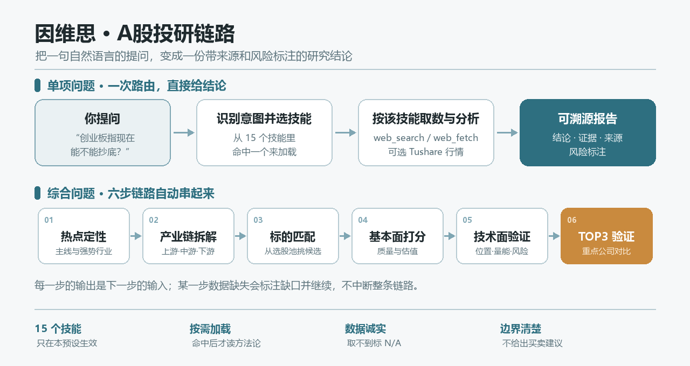

# invest-skill投研专家

一位会用工具、会自己查证据的 A 股投研分析师。你不用记技能名，像问同事一样提问——
它判断该用哪套方法，加载对应技能，再按那套方法取数、算指标、写报告。



---

## 30 秒上手

1. **新建会话** → 在预设列表里选「**invest-skill投研专家**」
2. **直接提问**（不用记技能名，说人话就行）
3. 需要成稿时会写入工作区 `reports/`，可直接打开或另存

### 可以直接复制的三句

| 想问什么 | 直接说 |
|---|---|
| 判断能不能抄底 | 创业板指现在能不能抄底？用三层决策检查表给结论 |
| 两只股票对比 | 对比分析贵州茅台和五粮液，出一份分析师级对比报告 |
| 全景找机会 | 帮我做今日 A 股投研全景分析，最后给 TOP3 重点公司验证 |

### 左侧栏「投研看板」

装好后左侧导航会多一行 **投研看板**（图标 + 文字），点开是中央面板：

- 15 个技能按「宏观与事件 / 标的分析 / 行情复盘 / 量化与策略」分组，每条写明什么时候用
- 三句常用提问，点一下直接复制
- 数据来源与边界说明

面板是纯前端展示，不发起任何请求，也不改变对话内容；收起侧栏时以图标 + tooltip 呈现。
该入口需要**重启 DSH** 后出现（客户端模块在启动时装配）。

---

## 能做什么

### 宏观与事件（8 个）

| 技能 | 什么时候用 |
|---|---|
| `policy-interpretation` | 解读政策文件、判断政策对行业/市场的影响 |
| `stock-market-spotlight-analysis` | 本周热点、市场主线、板块资金流向 |
| `industry-brief` | 申万一级行业强弱排名 + 资金流 |
| `concept-chain-analysis` | 算力/固态电池这类主题的上下游环节拆解 |
| `macro-stock-analysis` | 宏观分析、美林时钟、PMI/社融/M1M2、行业轮动 |
| `a-share-bottom-monitor` | 抄底、底部信号、该不该加仓、路径风险 |
| `policy-bottom-monitor` | 政策托底强度 S/A/B/C/D 分级 |
| `sentiment-risk-warning` | 舆情风险、次日波动率风险分级（大盘/个股） |

### 标的分析（3 个，基金类暂未就绪）

| 技能 | 什么时候用 |
|---|---|
| `stock-5d-deep-analysis` | 个股五维诊断：基本面/技术面/资金面/消息面/估值 |
| `value-investing` | 价值投资：贵不贵、能不能买、自上而下选股、多股打分卡 |
| `stock-comparative-analysis` | 2–5 只标的横向对比（含 A+H） |

### 行情复盘（2 个）

| 技能 | 什么时候用 |
|---|---|
| `market-daily-review` | 今日收评：涨跌统计、板块、异动、龙虎榜 |
| `overnight-global-market-review` | 隔夜美股港股复盘 + A 股开盘前瞻 |

### 量化与策略（2 个）

| 技能 | 什么时候用 |
|---|---|
| `racing-quant-pick` | 量化选股、策略选股、可溯源选股池 |
| `aggressive-growth-strategy` | 小盘成长、中证 2000 轮动、A+~D 评级 |

---

## 综合问题会自动走六步

问「帮我找机会 / 做一份全景分析」时，按下面顺序层层收敛，每步都会告诉你进度：

**热点定性** → **产业链拆解** → **标的匹配** → **基本面打分** → **技术面与风险** → **TOP3 重点公司验证**

某一步数据缺失会明确标注缺口并继续，不会用编造的数字补上。

---

## 它不做什么（边界先说清）

- **不给买卖、仓位、止损建议**；个股统一称「重点公司验证」，不构成投资建议。
- **不编数字**：取不到就标「数据缺失 / N/A / 源不可用」，不降级到过期缓存，也不生成「看起来合理」的占位值。
- **事实与观点分开**：推断会明确标注为观点。
- 基金类能力（基金分析/对比/基金经理画像/一致性分析）**本版本未就绪**，问到时它会直接说明。

---

## 数据从哪来

| 来源 | 用途 | 开箱可用？ |
|---|---|---|
| `web_search` / `web_fetch` | 公开新闻、公告、研报、行情页面 | ✅ 是 |
| Tushare MCP（`mcp__tushare__*`） | 结构化行情、财务、龙虎榜等 | ⚙️ 可选：`$DSH_HOME/.env` 写 `TUSHARE_TOKEN` 后重启 |
| 技能自带 `scripts/` | 回测、打分卡、报表生成 | ⚙️ 需 Python 依赖（见下） |
| `mx-ds-mcp` / `westock-mcp` / `tdx-connector` | 上游技能正文提到的三个 MCP | ❌ 未内置，未配置时按缺口处理 |

- 运行脚本前会先取随附 Python 路径；缺 `pandas`、`akshare`、`tushare`、`scikit-learn` 等库时会**如实报错**，不会假装跑通。
- 内置行情快照（`a_share_bottom_monitor/data/`）截止 **2026-10-27**，增量更新需 Tushare。
- 技能正文里的 `python3`、`~/.hermes`、`.workbuddy` 属上游 WorkBuddy / Linux 环境示例，专家会按本机 PowerShell 与随附 Python 改写，不会照抄。

---

## 安装与卸载

三种装法，任选其一：

| 方式 | 命令 / 操作 |
|---|---|
| 插件页 | **插件 → 添加插件** → 选本地目录 |
| 命令行 | `dsh plugin add dsh-invest-skill`（已发布到 npm 时） |
| 源码 | `dsh plugin add https://github.com/chenxyzcyxpp/dsh-invest-skill` |

- **卸载**：插件页关闭/移除本 bundle。关闭后预设与 15 个技能一并消失，其他会话不受影响。
- **注意**：已有会话保留它启动时的预设；改用本专家需**新建会话**。
- 插件页里由 `@deepseek-ai/dsh-agent-preset` 提供的那一行就是本预设本身。

### 目录

```
package.json         # dsh.bundle.patch 指向 cordis.patch.yml
cordis.patch.yml     # 预设声明 + 客户端入口行 + Tushare MCP 预留行
index.js             # 本包被挂载的那一行（宿主空实现，供客户端模块依附）
provider.js          # 把 skills/ 注册为技能提供者，只挂在预设内部
client.js            # 左侧栏「invest-skill投研专家」入口与投研看板面板
skills/              # 15 个技能（SKILL.md + references/ + scripts/ + templates/，部分含 data/）
locale/              # 插件页标题与描述（zh / en）
docs/                # 详情页特性图
icon.jpg             # 插件图标
README.md            # 本文件，即插件详情页的内容
```

## 与上游同步

`skills/` 是 [chenxyzcyxpp/invest-skill](https://github.com/chenxyzcyxpp/invest-skill) 的镜像，最近一次同步：
**2026-11-26**（上游 `9dee1cc`，`docs: 重写 README（功能优先、速览置顶）`）。

同步时保留了两处 DSH 适配：

1. `market-daily-review`、`policy-bottom-monitor` 的 frontmatter `name` 改为 kebab-case（DSH 技能注册表的要求）；
2. 上游仍假设「妙想 / 腾讯自选股 / 通达信 MCP 已连接」、并把 Python 指向 WorkBuddy 托管 venv——这些段落已改写为「未配置即按缺口处理，用随附 Python 运行」。

上游近期把数据源配置从「平台 dependencies 声明」改成了**环境变量**：策略库用 `RACING_DB_HOST` / `RACING_DB_USER` / `RACING_DB_PASSWORD` / `RACING_DB_NAME`，Tushare 用 `TUSHARE_TOKEN`（缺失时向用户索要，不静默降级）。

---

## 许可与免责

- 本 bundle：**Apache-2.0**（见 `LICENSE`）。
- 随包分发的 15 个技能改编自 [invest-skill](https://gitee.com/chenxyzcyxpp/invest-skill)（Apache-2.0），
  原始版权与署名见 `UPSTREAM_LICENSE` 与 `UPSTREAM_NOTICE`。
- 本包不包含、不分发行情数据；数据源由使用者自行接入并遵守相应服务条款。

> 本项目内容仅用于技术研究与方法论参考，不构成任何投资建议、证券推荐或收益承诺。市场有风险，投资需谨慎。
